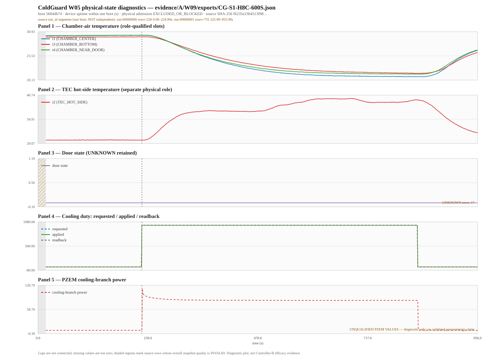

# ColdGuard W05 — Real Telemetry QA Report

Diagnostic QA over the W04 source-aware intake. No model training, no predictive feature construction, and no physical re-adjudication.

## 0. Five independent statuses

**Source 1: `evidence/A/W09/exports/CG-S1-H8C-600S.json`**

| Status | Value |
|---|---|
| QA_EXECUTION_STATUS | COMPLETED |
| SOURCE_STRUCTURE_STATUS | VALID |
| CHANNEL_QUALITY_STATUS | ATTENTION_REQUIRED |
| PHYSICAL_ADMISSION_STATUS | EXCLUDED_OR_BLOCKED (highest stage: USABLE_FOR_DIAGNOSTIC_QA) |
| PREDICTIVE_DATASET_READINESS | NOT_READY |

A single `PASS` never implies that all five statuses are green.

## 1. Provenance

| Field | Value |
|---|---|
| Report schema | coldguard-w05-qa-report-v1 |
| Package version | 0.1.0 |
| QA layer version | coldguard-w05-qa-v1 |
| Analysis code SHA-256 | `3c86d50b8d1a238f4d2b8916c3e10788f09a13e360b7ac8d0d53c58fb7ab66ca` |
| Repository revision | 62d70b9e5c5f291222954118c1f2f2b734a0cae4 |
| Generation command | `real-data-qa-v1.py --source ../evidence/A/W09/exports/CG-S1-H8C-600S.json --a-run-index ../evidence/A/W09/s1-run-index.json --format both --long-gap-ms 5000 --flatline-min-observations 10 --flatline-min-span-s 0.0 --flatline-temperature-tolerance-c 0.0625 --stale-age-ms 5000 --percentile linear --repository-revision 62d70b9e5c5f291222954118c1f2f2b734a0cae4 --out reports/W05` |
| Output directory | `ml/reports/W05` |
| A run index | `evidence/A/W09/s1-run-index.json` (SHA-256 `eb71d3f58004a25e60315b39ed88e33daa7e069a7a1fc3df391713cfce33b5af`) |

| Run-index field | Value |
|---|---|
| index_version | w09-run-index-v1 |
| runs_total | 1 |
| runs_usable_majority | 0 |
| valid S1 run IDs for B | NONE |
| blocked run IDs | 56044b74 |

## 2. Suite summary

| Field | Value |
|---|---|
| Analyzed sources | 1 |
| Unique physical sources | 1 |
| Duplicate views | 0 |
| Eligible S1 runs | 0 |
| Eligible S2 runs | 0 |
| Predictive dataset readiness | NOT_READY |
| Conflicting duplicate-view admissions | 0 |

### Row / boot / run / eligibility separation

| Concept | Count | Meaning |
|---|---|---|
| Recorded rows | 957 | observations in the analyzed sources; not experiments |
| Analyzed boot sessions | 1 | one boot domain per session; uptime is never joined across boots |
| Unique physical sources | 1 | deduplicated by device/boot session, not by filename or run label |
| Duplicate views | 0 | repeated exports of one physical source; not new independent runs |
| A-valid S1 run IDs | 0 | authoritative A hand-off list |
| W04 eligible S1 runs | 0 | physically qualified and predictively admissible |
| W04 eligible S2 runs | 0 | physically qualified and predictively admissible |
| Predictive dataset readiness | NOT_READY | training/validation availability under W04 admission |

> These counts are not interchangeable. A large row count, a boot session, an A-valid run and an ML-eligible run are four different units.

## 3. Per-source QA

### Source 1 — `evidence/A/W09/exports/CG-S1-H8C-600S.json`

| Field | Value |
|---|---|
| Source file | `evidence/A/W09/exports/CG-S1-H8C-600S.json` |
| SHA-256 | `f6235e23b4513f98ba7c1deb289f4a3d48afd3c0a87d7f38bfe4e67b2fc79feb` |
| Source format | `a-w09-run-export-v2` |
| Schema namespace | `w09-run-export/v2` |
| Companion row-validity CSV SHA-256 | `da27b2668097c207dd679e563fc18322742d68dfb4eb5a894f64958be35eebaf` |
| Physical evidence category | REAL MEASURED (producer declares physical) |
| Producer physical flag | True |
| A validity evidence | INVALID |
| Rows | 957 |
| Analyzed sessions | 1 |

| Pinned L0 source | SHA-256 | Exists |
|---|---|---|
| evidence/A/W04/tec-cooling-response-600s.csv | f8716b5136f34542225b366c238be4e65ce309e78593e8bad90d578af9a7c14d | True |

#### Run / session inventory

| Identity field | Value | Status |
|---|---|---|
| run_id | None | UNRESOLVED_MULTIPLE_SOURCE_RUN_IDS_IN_ONE_BOOT_ID |
| run_ids | run-00000000, run-00000001 | UNRESOLVED_MULTIPLE_SOURCE_RUN_IDS_IN_ONE_BOOT_ID |
| boot_id | 56044b74 | SOURCE_CARRIED_SINGLE |
| device_id | None | NOT_CARRIED_BY_THIS_ENCODING |
| hardware_config_id | CG-HW-001 | DECLARED_NOT_VERIFIED |
| firmware_version | cg-w04-0.1.0 | CARRIED |
| calibration_id | None | NOT_AVAILABLE |
| scenario_id | S1 | CANDIDATE_NOT_CERTIFIED |
| controller_id | None | NOT_CARRIED |
| device_run_label | H8C_BOX_COOLING_600S | LABEL_NOT_A_RUN_ID |
| time domain | BOOT_SCOPED_UPTIME | UNAVAILABLE |
| clock sync | NOT_EVIDENCED | device has no wall clock; device_ms is uptime since boot_id, host capture time is a separate domain |

| Session | Rows | Unique identities | Duplicate identities | Scientific usable rows | Scientific sample coverage |
|---|---|---|---|---|---|
| NO_DEVICE_ID::56044b74 | 957 | 957 | 0 | 0 | 0.000% |

**Source run_id segments (one boot; not independent runs):** Multiple `run_id` segments inside one boot are **not** independent runs and are not split into separate sessions or trajectories.

| Session | Source run_id | Rows | Start (s) | End (s) |
|---|---|---|---|---|
| NO_DEVICE_ID::56044b74 | run-00000000 | 226 | 0.000 | 224.990 |
| NO_DEVICE_ID::56044b74 | run-00000001 | 731 | 225.990 | 955.990 |
Chamber-air slots: ['t1', 't3', 't4']; TEC hot-side slots: ['t2']; unknown role slots: NONE.

**Sensor role evidence (canonical vs as-built):** Doc 01 §6.4 defines canonical T1/T2/T3 as near-door/central/far air regions. This hardware's source carries an operator-frozen as-built record; the table below is the authoritative role mapping used here. W05 does not apply the canonical three-air-probe wording to this as-built slot map, and T2 never enters a chamber-air aggregate.

| Slot | ROM | ROM readback verified | Physical position | Position source | In chamber-air aggregate | Raw roles in capture | Role conflict |
|---|---|---|---|---|---|---|---|
| t1 | 287088CA00000051 | False | CHAMBER_CENTER | OPERATOR_FROZEN_AS_BUILT_2026-11-02_PROBE_IDENTIFICATION_RECORD_NOT_REMEASURED_BY_W09 | True | UNASSIGNED | NONE |
| t2 | 28AEBF2200000006 | False | TEC_HOT_SIDE | OPERATOR_FROZEN_AS_BUILT_2026-11-02_PROBE_IDENTIFICATION_RECORD_NOT_REMEASURED_BY_W09 | False | HOT_SIDE | NONE |
| t3 | 28CBE9CA00000072 | False | CHAMBER_BOTTOM | OPERATOR_FROZEN_AS_BUILT_2026-11-02_PROBE_IDENTIFICATION_RECORD_NOT_REMEASURED_BY_W09 | True | UNASSIGNED | NONE |
| t4 | 283BE5C9000000A9 | False | CHAMBER_NEAR_DOOR | OPERATOR_FROZEN_AS_BUILT_2026-11-02_PROBE_IDENTIFICATION_RECORD_NOT_REMEASURED_BY_W09 | True | UNASSIGNED | NONE |

> ROM readback is not verified by the source. Positions are the operator-frozen as-built record, not a W05 physical re-measurement; this limitation is carried into W08.

#### Sampling QA (B-W05-01)

Percentile method: `linear`. Long-gap rule: a positive interval strictly greater than `5000 ms` (`DIAGNOSTIC_ONLY_CONFIGURABLE_THRESHOLD_NOT_A_FEATURE_ELIGIBILITY_LIMIT`).

| Session | Time base | Rows | Intervals | Median Δt (s) | P95 Δt (s) | Min / max positive Δt (s) | Nominal cadence (s) | Jitter median / P95 abs (s) | Long gaps | Long-gap duration (s) | Zero intervals | Negative intervals | Seq-missing estimate | Time-missing estimate | Observed window (s) | Expected samples | Captured-frame completeness | Completeness status | Campaign completeness |
|---|---|---|---|---|---|---|---|---|---|---|---|---|---|---|---|---|---|---|---|
| NO_DEVICE_ID::56044b74 | TRUSTED_BOOT_SCOPED_UPTIME | 957 | 956 | 1.000000 | 1.000000 | 0.990000 / 1.000000 | 1.000000 (INFERRED_MODAL_OBSERVED_INTERVAL, HIGH) | 0.000000 / 0.000000 | 0 | 0 | 0 | 0 | 0 | 0 | 955.990 | 957 | 100.000% | PROVISIONAL_DIAGNOSTIC | NOT_ESTIMABLE_ACQUISITION_BOUNDARIES_UNVERIFIED |

> Captured-frame completeness is provisional: the nominal cadence is inferred from observed intervals unless the caller supplied `--nominal-cadence-ms`, and acquisition boundaries/schedule are not carried by the source. It is not an authoritative campaign percentage.

> The observed window is `last time − first time` inside one boot, not a campaign duration; the source's acquisition schedule and stop boundary are not carried, so campaign completeness is NOT_ESTIMABLE.

> A sequence gap is not proof of a missing physical sample unless the source's sequence semantics are unit-incrementing; the classification is recorded per session.

**Chamber-air spread G_T = max − min (Doc 03 §121):** computed only from role-qualified chamber-air slots; the TEC hot-side channel is never included. This is a diagnostic distribution, not a threshold or a product-quality claim.

| Session | Air slots | n | Min (°C) | Median (°C) | P95 (°C) | Max (°C) | Max at (s) |
|---|---|---|---|---|---|---|---|
| NO_DEVICE_ID::56044b74 | t1, t3, t4 | 957 | 0.000 | 0.688 | 1.062 | 1.126 | 517.990 |

#### Channel QA (B-W05-02)

Quality columns are `VALID/DEGRADED/INVALID/UNKNOWN` counts from the source's quality domain applicable to the channel; when the source carries no verdict for that domain the row is counted as UNKNOWN and the reason code says so. Missing, measured zero, duplicate identity, flatline candidate and stale candidate remain distinct.

| Session | Channel | Family | Physical role | Unit | Rows | Present | Missing | Missing % | V/D/I/U | Impossible | Flatline candidates | Stale candidates | Duplicate identity | Diagnostic status | Reason codes |
|---|---|---|---|---|---|---|---|---|---|---|---|---|---|---|---|
| NO_DEVICE_ID::56044b74 | applied_cooling_state | ACTUATION | APPLIED_COOLING_STATE | state | 957 | 952 | 0 | 0.000% | 0/940/17/0 | 0 | N/A | N/A | 0 | DIAGNOSTIC_CAUTION | APPLIED_COOLING_STATE_UNOBSERVED, SOURCE_QUALITY_DEGRADED, SOURCE_QUALITY_INVALID |
| NO_DEVICE_ID::56044b74 | applied_duty_permille | ACTUATION | APPLIED_DUTY | permille | 957 | 957 | 0 | 0.000% | 0/940/17/0 | 0 | N/A | N/A | 0 | DIAGNOSTIC_CAUTION | SOURCE_QUALITY_DEGRADED, SOURCE_QUALITY_INVALID |
| NO_DEVICE_ID::56044b74 | cooling_current_a | PZEM-017 | COOLING_BRANCH_CURRENT | A | 957 | 957 | 0 | 0.000% | 0/0/0/957 | 0 | N/A | N/A | 0 | DIAGNOSTIC_READABLE_UNQUALIFIED | SOURCE_QUALITY_UNKNOWN |
| NO_DEVICE_ID::56044b74 | cooling_energy_counter_wh | PZEM-017 | COOLING_BRANCH_ENERGY_COUNTER | Wh | 957 | 957 | 0 | 0.000% | 0/0/0/957 | 0 | N/A | N/A | 0 | DIAGNOSTIC_READABLE_UNQUALIFIED | PZEM_ENERGY_UNQUALIFIED_DIAGNOSTIC_ONLY, SOURCE_QUALITY_UNKNOWN |
| NO_DEVICE_ID::56044b74 | cooling_power_w | PZEM-017 | COOLING_BRANCH_POWER | W | 957 | 957 | 0 | 0.000% | 0/0/0/957 | 0 | N/A | N/A | 0 | DIAGNOSTIC_READABLE_UNQUALIFIED | PZEM_POWER_UNQUALIFIED_DIAGNOSTIC_ONLY, SOURCE_QUALITY_UNKNOWN |
| NO_DEVICE_ID::56044b74 | cooling_voltage_v | PZEM-017 | COOLING_BRANCH_VOLTAGE | V | 957 | 957 | 0 | 0.000% | 0/0/0/957 | 0 | N/A | N/A | 0 | DIAGNOSTIC_READABLE_UNQUALIFIED | SOURCE_QUALITY_UNKNOWN |
| NO_DEVICE_ID::56044b74 | device_ms | TIME | BOOT_SCOPED_UPTIME | ms | 957 | 957 | 0 | 0.000% | 957/0/0/0 | 0 | N/A | N/A | 0 | DIAGNOSTIC_QUALIFIED | NONE |
| NO_DEVICE_ID::56044b74 | door_polarity | DOOR | DOOR_POLARITY_EVIDENCE | state | 957 | 957 | 0 | 0.000% | 0/0/0/957 | 0 | N/A | N/A | 0 | DIAGNOSTIC_READABLE_UNQUALIFIED | DOOR_POLARITY_UNCONFIRMED_PRESENT, SOURCE_QUALITY_UNKNOWN |
| NO_DEVICE_ID::56044b74 | door_state | DOOR | CHAMBER_DOOR | state | 957 | 940 | 0 | 0.000% | 0/0/0/957 | 0 | N/A | N/A | 0 | DIAGNOSTIC_READABLE_UNQUALIFIED | DOOR_NO_OPEN_EVENT_IN_CAPTURE, DOOR_STATE_UNKNOWN_PRESENT, SOURCE_QUALITY_UNKNOWN |
| NO_DEVICE_ID::56044b74 | pressure_hpa | BME280 | ENVIRONMENT_CONTEXT_NOT_P0_FEATURE | hPa | 957 | 957 | 0 | 0.000% | 0/0/0/957 | 0 | 0 | N/A | 0 | DIAGNOSTIC_READABLE_UNQUALIFIED | SOURCE_QUALITY_UNKNOWN |
| NO_DEVICE_ID::56044b74 | readback_duty_permille | ACTUATION | READBACK_DUTY | permille | 957 | 957 | 0 | 0.000% | 0/940/17/0 | 0 | N/A | N/A | 0 | DIAGNOSTIC_CAUTION | SOURCE_QUALITY_DEGRADED, SOURCE_QUALITY_INVALID |
| NO_DEVICE_ID::56044b74 | requested_duty_permille | ACTUATION | REQUESTED_DUTY | permille | 957 | 957 | 0 | 0.000% | 0/940/17/0 | 0 | N/A | N/A | 0 | DIAGNOSTIC_CAUTION | SOURCE_QUALITY_DEGRADED, SOURCE_QUALITY_INVALID |
| NO_DEVICE_ID::56044b74 | rh_pct | BME280 | ENVIRONMENT_CONTEXT | percent_RH | 957 | 957 | 0 | 0.000% | 0/0/0/957 | 0 | 0 | N/A | 0 | DIAGNOSTIC_READABLE_UNQUALIFIED | SOURCE_QUALITY_UNKNOWN |
| NO_DEVICE_ID::56044b74 | seq | IDENTITY | SEQUENCE | count | 957 | 957 | 0 | 0.000% | 957/0/0/0 | 0 | N/A | N/A | 0 | DIAGNOSTIC_QUALIFIED | NONE |
| NO_DEVICE_ID::56044b74 | t1 | DS18B20 | CHAMBER_CENTER | degC | 957 | 957 | 0 | 0.000% | 957/0/0/0 | 0 | 13 | 0 | 0 | DIAGNOSTIC_QUALIFIED | FLATLINE_CANDIDATE_DIAGNOSTIC_ONLY, FLATLINE_FIRST_SPAN_0.000_125.990s |
| NO_DEVICE_ID::56044b74 | t2 | DS18B20 | TEC_HOT_SIDE | degC | 957 | 957 | 0 | 0.000% | 957/0/0/0 | 0 | 13 | 0 | 0 | DIAGNOSTIC_QUALIFIED | FLATLINE_CANDIDATE_DIAGNOSTIC_ONLY, FLATLINE_FIRST_SPAN_0.000_21.990s |
| NO_DEVICE_ID::56044b74 | t3 | DS18B20 | CHAMBER_BOTTOM | degC | 957 | 957 | 0 | 0.000% | 957/0/0/0 | 0 | 15 | 0 | 0 | DIAGNOSTIC_QUALIFIED | FLATLINE_CANDIDATE_DIAGNOSTIC_ONLY, FLATLINE_FIRST_SPAN_0.000_164.990s |
| NO_DEVICE_ID::56044b74 | t4 | DS18B20 | CHAMBER_NEAR_DOOR | degC | 957 | 957 | 0 | 0.000% | 957/0/0/0 | 0 | 15 | 0 | 0 | DIAGNOSTIC_QUALIFIED | FLATLINE_CANDIDATE_DIAGNOSTIC_ONLY, FLATLINE_FIRST_SPAN_0.000_47.990s |
| NO_DEVICE_ID::56044b74 | t_air_c | BME280 | ENVIRONMENT_CONTEXT | degC | 957 | 957 | 0 | 0.000% | 0/0/0/957 | 0 | 5 | N/A | 0 | DIAGNOSTIC_READABLE_UNQUALIFIED | FLATLINE_CANDIDATE_DIAGNOSTIC_ONLY, FLATLINE_FIRST_SPAN_21.990_35.990s, SOURCE_QUALITY_UNKNOWN |

The machine-readable equivalent with all required columns is `channel-summary.csv`.

**UNQUALIFIED PZEM:** cooling-branch power/energy are present but the electrical quality domain is not VALID for every row, a value is missing, or an impossible value is present. They are plotted for diagnostics only and never become validated power, energy, COP or whole-system claims.

#### Physical-state plots (B-W05-03)



Session `NO_DEVICE_ID::56044b74`: one aligned time domain per panel set. Gaps are not connected, missing values are not zero-filled, TEC hot-side is separate from chamber air, and unqualified PZEM power is dashed and marked diagnostic-only.

#### Findings and anomalies

| Code | Severity | Scope | Channel | Count | Evidence |
|---|---|---|---|---|---|
| CHANNEL_SOURCE_QUALITY_INVALID | MEDIUM | channel | applied_cooling_state | 17 | source marked observations INVALID; kept visible |
| CHANNEL_SOURCE_QUALITY_INVALID | MEDIUM | channel | applied_duty_permille | 17 | source marked observations INVALID; kept visible |
| CHANNEL_SOURCE_QUALITY_UNKNOWN | LOW | channel | cooling_current_a | 957 | values may exist but are unqualified for evidence |
| CHANNEL_SOURCE_QUALITY_UNKNOWN | LOW | channel | cooling_energy_counter_wh | 957 | values may exist but are unqualified for evidence |
| CHANNEL_SOURCE_QUALITY_UNKNOWN | LOW | channel | cooling_power_w | 957 | values may exist but are unqualified for evidence |
| PZEM_POWER_UNQUALIFIED | INFO | channel | cooling_power_w | 957 | plotted for diagnostics only; not validated power or energy evidence |
| CHANNEL_SOURCE_QUALITY_UNKNOWN | LOW | channel | cooling_voltage_v | 957 | values may exist but are unqualified for evidence |
| CHANNEL_SOURCE_QUALITY_UNKNOWN | LOW | channel | door_polarity | 957 | values may exist but are unqualified for evidence |
| CHANNEL_SOURCE_QUALITY_UNKNOWN | LOW | channel | door_state | 957 | values may exist but are unqualified for evidence |
| DOOR_NO_QUALIFYING_OPEN_EVENT | INFO | channel | door_state | 0 | no OPEN interval observed; no door disturbance may be claimed from this capture |
| DOOR_STATE_UNKNOWN_PRESENT | LOW | channel | door_state | 17 | UNKNOWN is retained; it is never interpreted as CLOSED |
| CHANNEL_SOURCE_QUALITY_UNKNOWN | LOW | channel | pressure_hpa | 957 | values may exist but are unqualified for evidence |
| CHANNEL_SOURCE_QUALITY_INVALID | MEDIUM | channel | readback_duty_permille | 17 | source marked observations INVALID; kept visible |
| CHANNEL_SOURCE_QUALITY_INVALID | MEDIUM | channel | requested_duty_permille | 17 | source marked observations INVALID; kept visible |
| CHANNEL_SOURCE_QUALITY_UNKNOWN | LOW | channel | rh_pct | 957 | values may exist but are unqualified for evidence |
| CHANNEL_FLATLINE_CANDIDATE | LOW | channel | t1 | 13 | sustained constant span at measurement resolution; a candidate only, never proof of sensor failure |
| CHANNEL_FLATLINE_CANDIDATE | LOW | channel | t2 | 13 | sustained constant span at measurement resolution; a candidate only, never proof of sensor failure |
| CHANNEL_FLATLINE_CANDIDATE | LOW | channel | t3 | 15 | sustained constant span at measurement resolution; a candidate only, never proof of sensor failure |
| CHANNEL_FLATLINE_CANDIDATE | LOW | channel | t4 | 15 | sustained constant span at measurement resolution; a candidate only, never proof of sensor failure |
| CHANNEL_FLATLINE_CANDIDATE | LOW | channel | t_air_c | 5 | sustained constant span at measurement resolution; a candidate only, never proof of sensor failure |
| CHANNEL_SOURCE_QUALITY_UNKNOWN | LOW | channel | t_air_c | 957 | values may exist but are unqualified for evidence |
| CAMPAIGN_COMPLETENESS_NOT_ESTIMABLE | INFO | session | NONE | N/A | acquisition boundaries and schedule are not carried; filename or label duration is not used as evidence |
| RUN_ID_UNRESOLVED | MEDIUM | source | NONE | N/A | run_id_status=UNRESOLVED_MULTIPLE_SOURCE_RUN_IDS_IN_ONE_BOOT_ID; multiple filenames or row labels never create independent runs |
| W04_ADMISSION_BLOCKED | INFO | source | NONE | 8 | W04 highest stage USABLE_FOR_DIAGNOSTIC_QA; the diagnostic view remains readable |
| SENSOR_ROM_READBACK_UNVERIFIED | LOW | source | t1, t2, t3, t4 | 4 | the sensor block carries ROMs whose readback is not verified; positions come from the operator-frozen as-built record, not from a W05 re-measurement |
| HOT_SIDE_EXCLUDED_FROM_CHAMBER_AIR | INFO | source | t2 | N/A | TEC hot-side channel is reported separately, never as chamber air |

#### Scientific limits

- Captured-frame completeness is provisional; campaign completeness is NOT_ESTIMABLE without source-carried acquisition boundaries.
- Long-gap and stale thresholds are named diagnostic-only configuration, not feature-eligibility limits.
- Flatline results are FLATLINE_CANDIDATE only; repeated equal values do not prove sensor failure, and state/counter channels are not flatline-tested. Spans break on a missing value, a source-quality INVALID row or an interval above the long-gap threshold, not on every gap in the timestamp series.
- PZEM power/energy values are diagnostic only while the electrical quality domain is not VALID; no validated power, energy, COP or whole-system claim is made.
- TEC hot-side temperature is never chamber air and never enters a chamber-air mean or gradient.
- Unknown ROM/role, unknown door polarity and UNKNOWN door state remain unknown; none is silently converted.
- The W04 admission verdict is authoritative and unchanged; readable diagnostics never upgrade run validity.
- No interpolation, invented sensor value, cross-boot uptime subtraction or cross-boot absolute-time comparison is performed.
- No B-side run manifest exists in this repository; W05 consumes A's run index and reports run/session identity. Run-manifest consistency remains an A/C dependency.
- Predictive dataset readiness is NOT_READY; this report is a diagnostic audit, not a research dataset.

#### W06 / W08 handoff

**W06 (timing alignment) observations only — no W06 implementation:**

- `NO_DEVICE_ID::56044b74`: time base `TRUSTED_BOOT_SCOPED_UPTIME`, median Δt 1.000000 s, P95 1.000000 s, long gaps 0, zero intervals 0, sequence semantics `ALL_DELTAS_ONE`.

**W08 (dataset readiness) observations only — no W08 implementation:**

- Predictive dataset readiness: `NOT_READY`; eligible S1 runs 0; eligible S2 runs 0.
- Run identity status: `UNRESOLVED_MULTIPLE_SOURCE_RUN_IDS_IN_ONE_BOOT_ID`; multiple filenames or row labels were not counted as independent runs.
- Channel/run validity observations are in `channel-summary.csv`; the W04 admission ledger remains authoritative.

#### W04 admission verdict (unchanged by W05)

| Admission field | Value |
|---|---|
| status | EXCLUDED_OR_BLOCKED |
| highest stage | USABLE_FOR_DIAGNOSTIC_QA |
| eligible | False |
| eligible S1 runs | 0 |
| eligible S2 runs | 0 |
| predictive dataset readiness | NOT_READY |

| Stage | Blocker | Detail |
|---|---|---|
| PHYSICALLY_QUALIFIED | A_LEDGER_INVALID | A's authoritative validity ledger excludes this run: run_id_status=UNRESOLVED_MULTIPLE_SOURCE_RUN_IDS_IN_ONE_BOOT_ID: source run_id segments ['run-00000000', 'run-00000001'] under one boot_id are not independent runs and no joined run_id exists in the source, so none can be published for a join; majority of frames unusable |
| PHYSICALLY_QUALIFIED | RUN_ID_UNRESOLVED | run identity status 'UNRESOLVED_MULTIPLE_SOURCE_RUN_IDS_IN_ONE_BOOT_ID' is not a single source-carried run; no run_id is fabricated for a dataset join |
| PHYSICALLY_QUALIFIED | DEVICE_IDENTITY_UNAVAILABLE | device identity status 'NOT_CARRIED_BY_THIS_ENCODING'; cross-device identity cannot be asserted |
| PHYSICALLY_QUALIFIED | HARDWARE_CONFIG_UNVERIFIED | hardware configuration 'CG-HW-001' is a declared label; no verification evidence was supplied |
| PHYSICALLY_QUALIFIED | CALIBRATION_IDENTITY_MISSING | no calibration identity exists; a calibration id is never invented |
| ELIGIBLE_FOR_PREDICTIVE_DATASET | PHYSICALLY_QUALIFIED_REQUIRED | predictive admission requires the physically-qualified stage |
| ELIGIBLE_FOR_PREDICTIVE_DATASET | SCENARIO_POPULATION_INELIGIBLE | scenario 'S1' has no eligible rows under A's validity summary |
| ELIGIBLE_FOR_PREDICTIVE_DATASET | TIME_DOMAIN_INSUFFICIENT_FOR_PREDICTIVE_DATASET | time domain 'BOOT_SCOPED_UPTIME' / sync 'NOT_EVIDENCED' cannot support predictive event-time labels and EWT; boot-relative data stays diagnostic-only in W04 |

| Scenario | Eligible | Eligible rows | Blockers | Required domains |
|---|---|---|---|---|
| HEALTHY_ELECTRICAL_RANGES | False | 0 | NO_ELIGIBLE_ROWS_FOR_SCENARIO | provenance, producer, electrical, sequence |
| S1_NORMAL_BASELINE | False | 0 | NO_ELIGIBLE_ROWS_FOR_SCENARIO | provenance, producer, thermal, environment, door, sequence |
| S2_DOOR_DISTURBANCE | False | 0 | NO_ELIGIBLE_ROWS_FOR_SCENARIO, MISSING_EVENT_COVERAGE | provenance, producer, thermal, door, sequence |
| S3_THERMAL_EFFECTIVENESS_DEGRADATION | False | 0 | NO_ELIGIBLE_ROWS_FOR_SCENARIO | provenance, producer, thermal, electrical, sequence |
| S4_ACTUATION_RESPONSE_FAULT | False | 0 | NO_ELIGIBLE_ROWS_FOR_SCENARIO | provenance, producer, thermal, electrical, sequence |

## 4. Reproduction

```bash
cd ml
uv run --locked --python 3.12 --extra test python scripts/real-data-qa-v1.py --source ../evidence/A/W09/exports/CG-S1-H8C-600S.json --a-run-index ../evidence/A/W09/s1-run-index.json --format both --long-gap-ms 5000 --flatline-min-observations 10 --flatline-min-span-s 0.0 --flatline-temperature-tolerance-c 0.0625 --stale-age-ms 5000 --percentile linear --repository-revision 62d70b9e5c5f291222954118c1f2f2b734a0cae4 --out reports/W05
```

Repeated execution on the same source and configuration produces identical analytical numbers and stable serialized report content. The report contains no runtime generation timestamp and no local absolute path.
